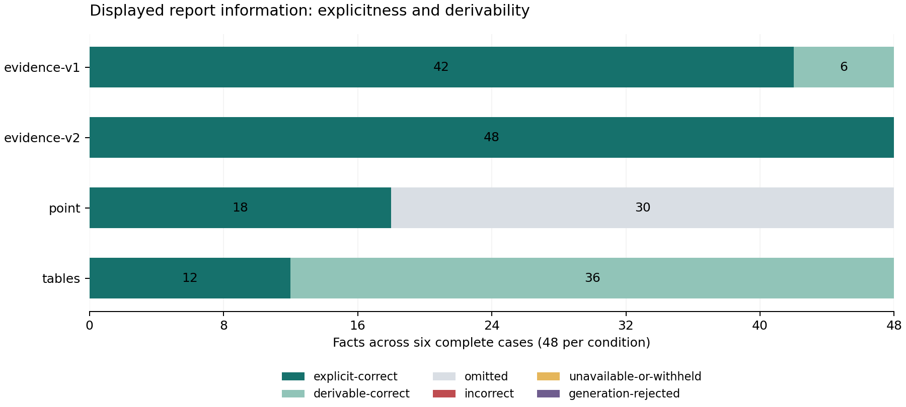

# Exploratory report revision: regression on the same known cases

**EXPLORATORY — development evidence after inspecting the primary results.** Evidence v2 was written in response to the observed report gaps. It uses the same nine cases and the unchanged primary extractor. This is not a predeclared v2 test, an independent validation set, a new solar experiment, or a human decision study.

The original point, table and evidence-v1 reports are copied byte for byte. All **216 original fact records** were recomputed and matched exactly. Their appearance beside v2 is a preserved reference comparison; the original primary results remain unchanged.

The six complete cases still provide 48 fact opportunities per condition. The two incomplete cases and one direct-renderer stress case remain separate. Any additional explicit coverage indicates that the revision now states a fact already available through arithmetic; it does not demonstrate better human decisions.

This is a known-answer functional test of the information in generated reports. It does not measure how quickly people read them, whether they make better decisions, or whether the solar model is physically accurate.

Frozen protocol: `report-information-evaluation-03`. Extraction rules: `report-markdown-rules-1.0.0`. Six complete arithmetic cases × eight questions = **48 fact opportunities per condition**. Incomplete and conflicting-input cases are kept outside that denominator.

## Reused complete cases: exploratory comparison

| Condition | Explicit correct | Additional derivable correct | Omitted | Incorrect | Unavailable / withheld | Generation rejected |
| --- | ---: | ---: | ---: | ---: | ---: | ---: |
| evidence-v1 | 42 | 6 | 0 | 0 | 0 | 0 |
| evidence-v2 | 48 | 0 | 0 | 0 | 0 | 0 |
| point | 18 | 0 | 30 | 0 | 0 | 0 |
| tables | 12 | 36 | 0 | 0 | 0 | 0 |

Explicit answers include a named winner and direct lookup of its value in a labelled candidate table. Ranking, subtraction and minima/maxima count as derivation. ‘Additional derivable’ excludes facts already explicit. An incorrect explicit assertion stays incorrect even if another displayed route gives the right answer. Missing answers are not scored as false claims.

Figure: the same six known cases, with preserved controls and an exploratory v2 revision. No independent generalisation is tested.

## Question-level results

Each cell shows explicit / additional derivable / incorrect counts out of six; other states are retained in the machine-readable results.

| Question | evidence-v1 | evidence-v2 | point | tables |
| --- | --- | --- | --- | --- |
| Q1: Nominal winner set with all ties and maximum nominal energy. | 6 / 0 / 0 | 6 / 0 / 0 | 6 / 0 / 0 | 0 / 6 / 0 |
| Q2: Minimax-regret winner set with all ties and minimum worst regret. | 6 / 0 / 0 | 6 / 0 / 0 | 0 / 0 / 0 | 0 / 6 / 0 |
| Q3: Omission sensitivity minimum/maximum and correct sensitivity, not probability, classification. | 6 / 0 / 0 | 6 / 0 / 0 | 0 / 0 / 0 | 0 / 6 / 0 |
| Q4: Count of option pairs reversing order across historical scenarios. | 6 / 0 / 0 | 6 / 0 / 0 | 0 / 0 / 0 | 0 / 6 / 0 |
| Q5: Worst-regret reduction minimum/maximum across all nominal ties, including explicit zero benefit. | 6 / 0 / 0 | 6 / 0 / 0 | 0 / 0 / 0 | 0 / 6 / 0 |
| Q6: Nominal yield sacrificed by every robust winner; do not infer sacrifice from regret gain. | 0 / 6 / 0 | 6 / 0 / 0 | 0 / 0 / 0 | 0 / 6 / 0 |
| Q7: Available versus expected historical scenario count (4), with missing cells identified when relevant. | 6 / 0 / 0 | 6 / 0 / 0 | 6 / 0 / 0 | 6 / 0 / 0 |
| Q8: Finite-case/modelled-evidence scope; no measured output, future probability or human improvement claim. | 6 / 0 / 0 | 6 / 0 / 0 | 6 / 0 / 0 | 6 / 0 / 0 |

## Incomplete evidence and direct renderer stress

| Case | Condition | Outcome by question | Printed non-finite tokens |
| --- | --- | --- | --- |
| C07 — Missing historical value | point | Q1 explicit-correct; Q2 omitted; Q3 omitted; Q4 omitted; Q5 omitted; Q6 omitted; Q7 explicit-correct; Q8 explicit-correct | None |
| C07 — Missing historical value | tables | Q1 derivable-correct; Q2 unavailable-or-withheld; Q3 derivable-correct; Q4 unavailable-or-withheld; Q5 unavailable-or-withheld; Q6 unavailable-or-withheld; Q7 explicit-correct; Q8 explicit-correct | None |
| C07 — Missing historical value | evidence-v1 | Q1 generation-rejected; Q2 generation-rejected; Q3 generation-rejected; Q4 generation-rejected; Q5 generation-rejected; Q6 generation-rejected; Q7 generation-rejected; Q8 generation-rejected | None |

Producer rejection for C07 / evidence-v1: `Energy values must be finite, nonnegative and complete.`. This is an operational refusal, not an emitted false recommendation.

| C07 — Missing historical value | evidence-v2 | Q1 explicit-correct; Q2 unavailable-or-withheld; Q3 explicit-correct; Q4 unavailable-or-withheld; Q5 unavailable-or-withheld; Q6 unavailable-or-withheld; Q7 explicit-correct; Q8 explicit-correct | None |
| C08 — Missing omission results | point | Q1 explicit-correct; Q2 omitted; Q3 omitted; Q4 omitted; Q5 omitted; Q6 omitted; Q7 explicit-correct; Q8 explicit-correct | None |
| C08 — Missing omission results | tables | Q1 derivable-correct; Q2 derivable-correct; Q3 unavailable-or-withheld; Q4 derivable-correct; Q5 derivable-correct; Q6 derivable-correct; Q7 explicit-correct; Q8 explicit-correct | None |
| C08 — Missing omission results | evidence-v1 | Q1 explicit-correct; Q2 explicit-correct; Q3 incorrect; Q4 explicit-correct; Q5 explicit-correct; Q6 derivable-correct; Q7 explicit-correct; Q8 explicit-correct | ∞, -∞ |
| C08 — Missing omission results | evidence-v2 | Q1 explicit-correct; Q2 explicit-correct; Q3 unavailable-or-withheld; Q4 explicit-correct; Q5 explicit-correct; Q6 explicit-correct; Q7 explicit-correct; Q8 explicit-correct | None |
| S01 — Cached robust choice conflicts with raw energy | point | Q1 explicit-correct; Q2 omitted; Q3 omitted; Q4 omitted; Q5 omitted; Q6 omitted; Q7 explicit-correct; Q8 explicit-correct | None |
| S01 — Cached robust choice conflicts with raw energy | tables | Q1 derivable-correct; Q2 derivable-correct; Q3 derivable-correct; Q4 derivable-correct; Q5 derivable-correct; Q6 derivable-correct; Q7 explicit-correct; Q8 explicit-correct | None |
| S01 — Cached robust choice conflicts with raw energy | evidence-v1 | Q1 explicit-correct; Q2 incorrect; Q3 explicit-correct; Q4 explicit-correct; Q5 explicit-correct; Q6 derivable-correct; Q7 explicit-correct; Q8 explicit-correct | None |
| S01 — Cached robust choice conflicts with raw energy | evidence-v2 | Q1 explicit-correct; Q2 explicit-correct; Q3 explicit-correct; Q4 explicit-correct; Q5 explicit-correct; Q6 explicit-correct; Q7 explicit-correct; Q8 explicit-correct | None |

The complete-study renderer normally receives validated producer output. Missing inputs and a deliberately stale cached choice probe that contract; they are not estimates of ordinary deployment error frequency. A safe refusal can avoid a false claim while still leaving the user without a report.

## Sheffield transfer example

The exploratory input also contains `transfer/sheffield-evidence-v2.md`, a revised presentation of the same previously inspected study. Its original evidence/model and the preserved v1 report remain unchanged. Neither transfer report contributes to benchmark counts.

The input bundle preserves the previously inspected Sheffield report byte for byte. It is a transfer example, not a new independent replication, and receives no synthetic benchmark percentage. Its text is retained at `transfer/sheffield-evidence-v1.md` in the input bundle.

## Interpretation limits

‘Equal-information’ refers to the same underlying inputs and question-answerability, not identical displayed fields. The table control displays the full historical matrix; the current evidence report displays derived candidate regrets and reversal summaries without every historical cell. Both can retain the arithmetic information needed for the questions. Differences in explicit coverage show which facts the report states for the reader; they do not establish a human performance advantage. The cases and parsers were designed with knowledge of the existing renderer. This small, deliberately diagnostic set supports functional checks, not statistical generalisation.

The evaluator reads actual Markdown. It imports no production calculation and does not read hidden audit assertions. The oracle uses frozen literal expected answers; Q2's scalar is a lookup in that literal key, and Q7's missing-cell requirement is a count of null markers in the frozen fixture. A closed-template parser is not a general natural-language truth checker. All extracted assertions and arithmetic routes remain reviewable in `evaluations.json`.

A report's word count is descriptive only. No usability score, weighted utility score, significance test or time-saving claim is made. Any later version run against these known cases must be labelled exploratory regression evidence.

## Provenance and reproduction

Input source commit: `d4d3372252ce82f3b08ad832d86f89777bd42223`. Evaluator commit: `d4d3372252ce82f3b08ad832d86f89777bd42223`. Protocol SHA-256: `b689786c0bf6dbd90f3ad71eb422e96931f5519ccec205fead3060aa30170660`. Input manifest SHA-256: `cd4c5abb83290fbeedc537aecdd6b08387ea407edfecd97279714d4302813ab7`.

`fact-scores.csv` contains one row per case, condition and question. `evaluations.json` contains the expected keys, exact extracted values, source descriptions and derivation routes. `manifest.json` hashes every output. `runtime.json` records interpreter and plotting versions.

## Preserved primary comparison

Primary source commit: `83687bf35bb34c16efdb95de74a00e0cb4f145ff`. Primary input manifest SHA-256: `b89499f9f662cfdf9543f75a2b8cf38b1c27c1bd652807b71ced734cb482e298`. Primary results manifest SHA-256: `11b027dd9e6bde5409197a8d013d58a9a843af451bcc0706aaeb7ac4b2dcbac1`.

Unchanged extractor SHA-256: `fe5dc66a53f394db2ff5fc42fb7434f0a22b6194f45eb870faf2a54958d35092`. Wrapper version: `report-exploration-wrapper-1.0.0`. The extraction functions, answer keys and numerical tolerances are unchanged. Only this separate runner supplies the additional condition and exploratory labelling.
